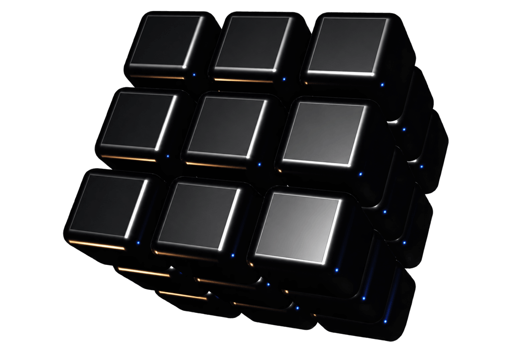

# Resend-inspired Three.js cube

A polished, independent interpretation of the iconic Resend cube, built with Three.js and browser-native JavaScript.

**[Open the live demo](https://jraddy.github.io/resend-inspired-threejs-cube/)**



This project grew out of [Peter’s Devs Love Coffee tutorial](https://www.devslovecoffee.com/blog/making-the-resend-cube-from-scratch-using-three-js), and early iterations used and refined its example code. The public version has since been substantially rewritten and extended by [Dario Simic](https://www.linkedin.com/in/dariosimic-de) / [RevoDev](https://revodev.de).

## What changed

The tutorial establishes the visual idea and development path. This implementation replaces its individual meshes, custom rounded-edge geometry, wrapper-group turns and third-party controls with:

- one `InstancedMesh` containing 27 cubies;
- Three.js `RoundedBoxGeometry`;
- coordinate and quaternion state for reversible layer turns on all three axes;
- direct pointer rotation with inertia;
- responsive render quality and camera framing;
- off-screen and hidden-tab pausing;
- reduced-motion and WebGL failure fallbacks; and
- explicit observer, event and GPU-resource cleanup.

The detailed source comparison is recorded in [PROVENANCE.md](./PROVENANCE.md).

## Controls

- Drag the cube to rotate the view.
- Select **Pause** to stop automatic rotation and layer turns.
- Select **Resume** to continue.
- Select **Reset** to restore the 3 × 3 × 3 arrangement and viewing orientation.

The demo honors `prefers-reduced-motion` and shows the static poster instead of initializing WebGL when reduced motion is requested.

## Run locally

Requirements: Node.js 22.12 or newer.

```bash
npm ci
npm run dev
```

Vite prints the local address. To test a production build:

```bash
npm run build
npm run preview
```

Run all repository checks with:

```bash
npm run check
```

## Reuse the cube

The scene is deliberately separate from the demo interface. Provide a host containing a canvas and mount it:

```html
<figure data-cube-scene>
  <canvas data-cube-canvas aria-hidden="true"></canvas>
  <figcaption>Interactive metallic cube made from 27 rounded pieces.</figcaption>
</figure>
```

```js
import { mountCubeScene } from "./src/cube.js";

const container = document.querySelector("[data-cube-scene]");
const cube = mountCubeScene(container);

cube?.pause();
cube?.resume();
cube?.reset();
cube?.dispose();
```

Your host must provide explicit dimensions. The demo’s styles are presentation-specific; the cube module only relies on the two data attributes shown above and reports its state through `data-render-state` and `data-render-reason` on the host.

## Architecture

- `src/cube.js` owns Three.js, scene state, input, animation and cleanup.
- `src/main.js` owns progressive initialization, reduced-motion behavior and accessible controls.
- `src/styles.css` and `index.html` form the framework-free exhibit.
- Three.js is pinned and bundled locally. The production page makes no runtime CDN request.

This repository is a demo and reusable source module, not a published npm package.

## Accessibility and performance

The canvas is a non-essential visual enhancement. Its meaning is available through the figure caption and static poster, while Pause/Resume and Reset are native keyboard-operable buttons. Focus styles remain visible, and status changes are announced through a restrained live region.

Rendering is capped to a moderate device-pixel ratio, uses instancing for all 27 pieces, pauses outside the viewport or in a hidden tab, and releases observers, listeners and GPU resources on disposal.

## Browser requirements

The interactive scene requires JavaScript, ES modules and WebGL2. Current Chrome, Edge, Firefox and Safari releases are the intended targets. Browsers without WebGL2 keep the static preview visible and report a fallback state.

## Troubleshooting

- **Only the image appears:** Check the status rail. Reduced-motion preferences and unavailable WebGL2 intentionally use the poster.
- **The local page has missing assets:** Start it through Vite rather than opening `index.html` directly.
- **The cube is paused:** Bring the tab into view, scroll the exhibit into the viewport, or select Resume if it was paused manually.
- **Changes do not appear on GitHub Pages:** Confirm the Pages workflow completed for the latest `main` commit.

## Credits and provenance

Credit for the original tutorial and example code goes to Peter / Devs Love Coffee:

1. [How to Create a 3D Resend Cube using Three.js from Scratch](https://www.devslovecoffee.com/blog/making-the-resend-cube-from-scratch-using-three-js)
2. [Resend Cube Lookalike – Part 2](https://www.devslovecoffee.com/blog/resend-cube-lookalike-part-2)
3. [Resend Cube Lookalike – Part 3](https://www.devslovecoffee.com/blog/resend-cube-lookalike-part-3)
4. [Devs Love Coffee source repository](https://github.com/devslovecoffee/devs-love-coffee)

Three.js is maintained by its contributors and distributed under the MIT License. See [THIRD_PARTY_NOTICES.md](./THIRD_PARTY_NOTICES.md).

## Independent-project notice

This project is inspired by Resend’s cube but is not affiliated with, sponsored by or endorsed by Resend. It contains no Resend logos, source code or other brand assets. The Resend name and visual identity belong to their respective owner.

## Contributing and security

Small, focused pull requests are welcome; read [CONTRIBUTING.md](./CONTRIBUTING.md) first. Please report security concerns according to [SECURITY.md](./SECURITY.md), not through a public issue.

## License

The rewritten implementation by Dario Simic is available under the [MIT License](./LICENSE). That license does not apply to the Devs Love Coffee articles or example files; see [NOTICE.md](./NOTICE.md) for the precise boundary.

## Maintainer

[Dario Simic](https://www.linkedin.com/in/dariosimic-de) · [RevoDev](https://revodev.de) · [GitHub](https://github.com/jraddy)

